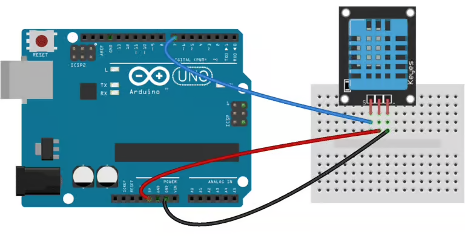

# Component Lab: DHT11 Temperature and Humidity Sensor
Microcontrollers can use sensors to collect information about the physical world. In this lab, you will learn how to use the DHT11 digital sensor to measure temperature (in degrees Celsius) and relative humidity (as a percentage). Relative humidity is the amount of water vapor in the air relative to how much it coudl hold.

# 1. Build the circuit
You will need the following components:
- Arduino Uno
- DHT11 temperature and humidity sensor (it will be a small blue component with a grid pattern)
- Breadboard
- Three jumper wires

The DHT11 has three pins that you will connect to the Arduino:

| DHT11 Pin | Arduino Pin |
| ----      | ----        |
| VCC (+)   | 5V          |
| Data / Out | Digital Pin 2 |
| GND (-)   | GND         |

This image should give you an idea of how the sensor can be wired.

# 2. Install the library
The folks at Adafruit when through the trouble of writing the complex code needed to interpret the electrical signals that come from the DHT11. Using a **library** you can read from the DHT11 using one simple line of code.

To install the library in the Arduino IDE, 
- go to **Sketch > Include Library > Manage Libraries **. 
- Search for the **DHT sensor library**
- Install the **DHT sensor library by Adafruit**.
- If prompted, **Adafruit Unified Sensor**.

You will be able to use the `readTemperature()` and `readHumidity()` functions that are part of the DHT object.

# 3. Program the Arduino

Use the starter code in `temp_sensor.ino` to get started. 

## Task 1: Document the setup function
Add a short comment with what you think the code in the setup function does. Use your context clues.

## Task 2: Read the sensor
In the global variable space, the variable `dht` was created. This is an object data type from the DHT11 library that provides two functions `readTemperature()` and `readHumidity()`. Because they belong to the `dht` variable, you need to put it before the functions and separate with a dot. `dht.readTemperature()` and `dht.readHumidity()`. 

Both functions return floats and you can store their values in a float variable.

## Task 3: Write a conversion function
The DHT11 returns temperatures in Celsius by default. To display the temperature in Fahrenheit, create a function named `celsiusToFahrenheit()`.

Your function must:
1. Accept one parameter of type float representing the Celsius temperature.
2. Calculate the Fahrenheit equivalent using the formula below.
3. Return the converted value.

`F = (C * 1.8) + 32`

Complete the function in the starter code, then call it inside `loop()` to convert the sensor's temperature reading.

## Task 4: Display measurements
Use `Serial.print()` and `Serial.println()` to display the temperature in both Celsius and Fahrenheit and the relative humidity.

| Function	| Behavior |
| ---       | ----     |
| `Serial.print(value)` |	Prints a value without moving to a new line |
| `Serial.println(value)` | 	Prints a value and starts a new line |

## Task 5: Upload and verify
Upload the code to your Arduino. Open the Serial Monitor in the Arduino IDE. Set the baud rate to 9600. Verify that your measurements appear every 5 seconds.

# 4. Test your sensor
Test that your sensor responds to changes in the environment.

### Test 1: Baseline

Leave the sensor undisturbed for approximately 60 seconds. Record the temperature and humidity.

**Observations:**

### Test 2: Temperature

Hold your hand near the sensor without touching the electrical connections. Observe whether the temperature changes.

**Observations:**

### Test 3: Humidity

Gently breathe toward the sensor from a short distance. Observe whether the humidity changes.

**Observations:**

### Results

Summarize your measurements in the table below.

| Test | Temperature (°C) | Humidity (%) | Observations |
|---|---|---|---|
| Baseline | | | |
| Temperature | | | |
| Humidity | | | |
